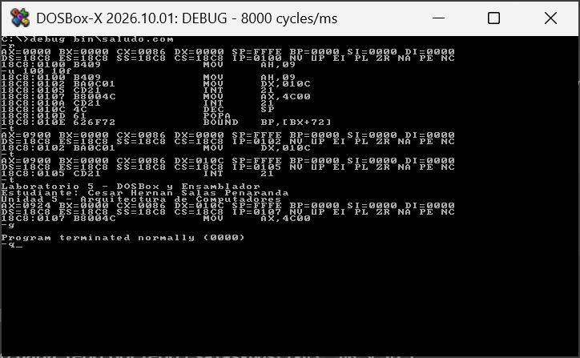
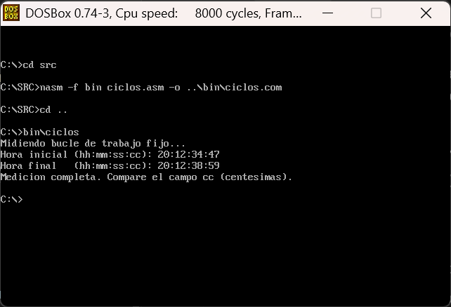
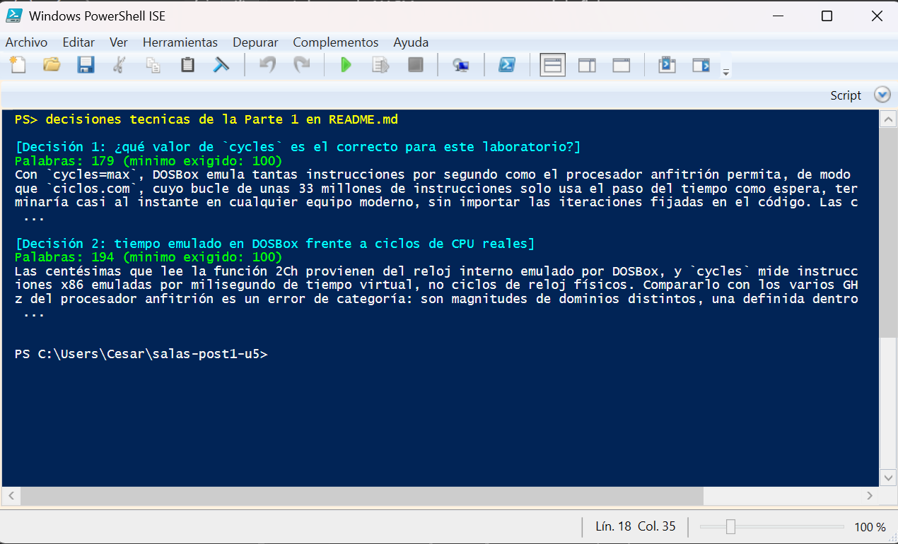

# salas-post1-u5

## Descripción

Laboratorio de la Unidad 5 de Arquitectura de Computadores (post-contenido): emulación con DOSBox (Parte 1) y virtualización con VirtualBox (Parte 2) en un único repositorio.

- **Estudiante:** Cesar Hernan Salas Peñaranda (cuenta de GitHub `cesarhernansp`)
- **Parte 1:** entorno DOSBox con NASM, tres programas en ensamblador (`saludo.com`, `entrada.com`, `ciclos.com`), verificación con DEBUG y comparación del parámetro `cycles`.
- **Parte 2:** máquina virtual Alpine Linux en VirtualBox, modos de red, snapshots, reasignación de recursos, comparación de discos y exportación OVA.

## Entorno de trabajo (Parte 1)

| Componente | Versión / detalle |
|---|---|
| Sistema anfitrión | Windows 11 Home, 16 GB de RAM |
| Emulador | DOSBox 0.74-3 |
| Depurador | `DEBUG.EXE` incluido en DOSBox-X 2026.10.01 (`Z:\DOS\DEBUG.EXE`), porque DOSBox 0.74-3 no trae DEBUG |
| Ensamblador | NASM 3.02 para DOS (`nasm.exe`, requiere un host DPMI: `cwsdpmi.exe`) |
| Editor | VS Code / editor de texto plano; archivos `.asm` en ASCII sin BOM |
| Control de versiones | Git en el anfitrión |

`nasm.exe` y `cwsdpmi.exe` se copian a la raíz del proyecto para que DOSBox los vea como `C:\`, pero no se versionan en el repositorio (son binarios de terceros).

## Estructura del repositorio

```
salas-post1-u5/
├── README.md              # documentación de ambas partes
├── dosbox.conf            # (Parte 1) configuración de DOSBox
├── src/                   # (Parte 1) saludo.asm, entrada.asm, ciclos.asm
├── bin/                   # (Parte 1) saludo.com, entrada.com, ciclos.com
├── VBoxManage_commands.sh # (Parte 2) comandos de VirtualBox
└── capturas/              # capturas de ambas partes, nombradas por checkpoint
```

## Parte 1: DOSBox, entorno de desarrollo en ensamblador

### Procedimiento

1. **Estructura.** Se crearon `src/`, `bin/` y `capturas/`, se inicializó Git con la rama `main` y se escribió este README (checkpoint 1).
2. **Configuración.** `dosbox.conf` fija `core=normal`, `cputype=auto`, `cycles=8000`, `memsize=16` y `scaler=normal2x`, y en `[autoexec]` monta la carpeta del proyecto como `C:`. Se agregó `path %PATH%;C:\` para invocar `nasm` desde `src\` y `cwsdpmi -p`, porque este `nasm.exe` es un ejecutable DJGPP que necesita un host DPMI residente (checkpoint 2).
3. **Programas** (formato `.COM`, `nasm -f bin`, `org 0x100`):
   - `saludo.asm`: imprime tres líneas con la función 09h de INT 21h (checkpoint 3).
   - `entrada.asm`: lee una tecla con la función 07h, la muestra con la 02h y escribe su código ASCII en hexadecimal (checkpoint 4).
   - `ciclos.asm`: lee la hora con la función 2Ch antes y después de un bucle de trabajo fijo (checkpoint 6).
4. **Depuración.** Se cargó `saludo.com` en DEBUG, se vieron los registros (`r`), el desensamblado (`u 100 10f`) y se ejecutaron tres pasos (`t`) y el resto (`g`) (checkpoint 5).
5. **Comparación de `cycles`.** Se ejecutó `ciclos.com` con 8000, 1000 y 20000, editando solo esa línea de `dosbox.conf` y reiniciando DOSBox cada vez (checkpoint 7).

### Notas de implementación

- **Orden de secciones.** Con `-f bin` las secciones se emiten en el orden en que aparecen. El enunciado declara `.data` antes de `.text`, lo que dejaría datos en `CS:0100h`, donde empieza la ejecución. En los tres programas `.text` va primero y `.data` al final.
- **Etiqueta del mensaje.** En `saludo.asm` la etiqueta `mensaje` apunta al inicio de la cadena de tres líneas; con `DX` apuntando a la segunda línea no se imprimiría la primera.
- **Tamaño del bucle.** El bucle externo de `ciclos.asm` es de 250 iteraciones (`ITER_EXT`) en lugar de 2000. Con 2000 y `cycles=1000` la corrida habría tardado varios minutos, y el enunciado permite ajustar ese valor. Se mantuvo igual en las tres corridas.
- **DEBUG.** DOSBox 0.74-3 no incluye `DEBUG.EXE`. La sesión se ejecutó con el `DEBUG.EXE` de DOSBox-X (`Z:\DOS`), con el mismo `dosbox.conf` (`cycles=8000`).
- **Ejecución de los comandos.** Los comandos de cada captura se ejecutaron con un archivo por lotes con `echo on`, de modo que el prompt `C:\>` muestra cada comando como si se hubiera tecleado. La tecla de `entrada.com` se envió a la ventana de DOSBox.

### Capturas de la Parte 1

| Checkpoint | Captura |
|---|---|
| 1. Estructura del directorio y `git status` | `capturas/cp1_estructura.png` |
| 2. DOSBox con prompt `C:\` y `nasm -v` | `capturas/cp2_dosbox_nasm.png` |
| 3. `saludo.com` | `capturas/cp3_saludo.png` |
| 4. `entrada.com` (tecla `a`, código `61`) | `capturas/cp4_entrada.png` |
| 5. Sesión DEBUG (`u` y tres pasos `t`) | `capturas/cp5_debug.png` |
| 6. `ciclos.com` con `cycles=8000` | `capturas/cp6_ciclos_8000.png` |
| 7. `ciclos.com` con `cycles=1000` y `cycles=20000` | `capturas/cp7_ciclos_1000.png`, `capturas/cp7_ciclos_20000.png` |
| 8. Decisiones técnicas de `cycles` (con recuento de palabras) | `capturas/cp8_cycles_decisiones.png` |








### Sesión DEBUG de `saludo.com`

Con `saludo.com` cargado (`debug bin\saludo.com`):

| Paso | Instrucción | Registros relevantes después |
|---|---|---|
| inicio (`r`) | — | `AX=0000`, `DX=0000`, `CX=0086` (tamaño del archivo, 134 bytes), `IP=0100` |
| `t` 1 | `MOV AH,09` en `0100` | `AX=0900`, `IP=0102` |
| `t` 2 | `MOV DX,010C` en `0102` | `DX=010C` (dirección de `mensaje`), `IP=0105` |
| `t` 3 | `INT 21` en `0105` | `AX=0924`, `IP=0107`: DOS imprime el mensaje y deja `AL=24h` (`$`) |
| `g` | — | el programa termina con `Program terminated normally` |

El desensamblado (`u 100 10f`) muestra `MOV AH,09` / `MOV DX,010C` / `INT 21` / `MOV AX,4C00` / `INT 21`; las filas siguientes son los bytes de la cadena de texto interpretados como instrucciones, algo esperable porque `.data` sigue al código.

### Comparación del efecto de `cycles`

El código fuente no cambia entre corridas; solo varía la línea `cycles` de `dosbox.conf`, y DOSBox se reinició después de cada cambio.

| Corrida | `cycles` | Hora inicial (hh:mm:ss:cc) | Hora final (hh:mm:ss:cc) | Duración observada (centésimas) |
|---|---|---|---|---|
| 1 | 8000 | 20:12:34:47 | 20:12:38:59 | 412 (4,12 s) |
| 2 | 1000 | 20:13:34:06 | 20:14:06:85 | 3279 (32,79 s) |
| 3 | 20000 | 20:14:46:07 | 20:14:47:66 | 159 (1,59 s) |

La duración con 1000 es unas 8 veces la de 8000 (3279 / 412 = 7,96) y la de 20000 es unas 2,6 veces menor (412 / 159 = 2,59), muy cerca de las razones teóricas 8 y 2,5. Esto confirma que `cycles` controla la velocidad de emulación y no la corrección del programa, que ejecuta exactamente las mismas instrucciones.

## Decisiones técnicas (Parte 1)

### Decisión 1: ¿qué valor de `cycles` es el correcto para este laboratorio?

Con `cycles=max`, DOSBox emula tantas instrucciones por segundo como el procesador anfitrión permita, de modo que `ciclos.com`, cuyo bucle de unas 33 millones de instrucciones solo usa el paso del tiempo como espera, terminaría casi al instante en cualquier equipo moderno, sin importar las iteraciones fijadas en el código. Las centésimas medidas dejarían de reflejar el diseño del programa y pasarían a reflejar la potencia del anfitrión, lo que invalida la medición. `cycles=auto` también es inadecuado, porque ajusta la velocidad dinámicamente según el programa activo y el resultado cambia de una corrida a otra. Un valor fijo como `cycles=8000` es determinista: cada milisegundo virtual ejecuta siempre el mismo número de instrucciones, por lo que los resultados son comparables entre equipos distintos. Los datos lo confirman: 412, 3279 y 159 centésimas para 8000, 1000 y 20000. Fuera de este laboratorio, `max` o `auto` sí son la opción correcta para software que no depende del reloj del procesador, como un compilador o ensamblador de DOS, una herramienta de productividad o un entorno como Windows 3.1, donde se busca terminar cuanto antes.

### Decisión 2: tiempo emulado en DOSBox frente a ciclos de CPU reales

Las centésimas que lee la función 2Ch provienen del reloj interno emulado por DOSBox, y `cycles` mide instrucciones x86 emuladas por milisegundo de tiempo virtual, no ciclos de reloj físicos. Compararlo con los varios GHz del procesador anfitrión es un error de categoría: son magnitudes de dominios distintos, una definida dentro de la máquina emulada y la otra en el silicio real. Además, cada instrucción de 16 bits emulada exige que DOSBox la interprete por software con un número variable de instrucciones nativas, de modo que el anfitrión ejecuta muchos más ciclos reales de los que sugiere `cycles`. Por eso `cycles` no indica el uso real de CPU de `DOSBox.exe`: con un valor fijo, DOSBox ejecuta su cuota de instrucciones en cada milisegundo y espera el resto, mientras que con `max` ocupa por completo un núcleo. Para estimar cuántos ciclos reales consume `ciclos.com` dentro de DOSBox hay que medir el proceso en el anfitrión con una herramienta del sistema operativo: el Administrador de tareas o el Monitor de rendimiento (`% de tiempo de procesador` de `DOSBox.exe`), o un perfilador como Windows Performance Analyzer o Process Explorer, y no leer `cycles` del archivo de configuración.
