# salas-post1-u5

## Descripción

Laboratorio de la Unidad 5 de Arquitectura de Computadores (post-contenido): emulación con DOSBox (Parte 1) y virtualización con VirtualBox (Parte 2) en un único repositorio.

- **Estudiante:** Cesar Hernan Salas Peñaranda (cuenta de GitHub `cesarhernansp`)
- **Parte 1:** entorno DOSBox con NASM, tres programas en ensamblador (`saludo.com`, `entrada.com`, `ciclos.com`), verificación con DEBUG y comparación del parámetro `cycles`.
- **Parte 2:** máquina virtual Alpine Linux en VirtualBox, modos de red, snapshots, reasignación de recursos, comparación de discos y exportación OVA.

## Entorno de trabajo (Parte 1)

| Componente | Versión / detalle |
|---|---|
| Sistema anfitrión | Windows 11 Home, 16 GB de RAM |
| Emulador | DOSBox 0.74-3 |
| Depurador | `DEBUG.EXE` incluido en DOSBox-X 2026.10.01 (`Z:\DOS\DEBUG.EXE`), porque DOSBox 0.74-3 no trae DEBUG |
| Ensamblador | NASM 3.02 para DOS (`nasm.exe`, requiere un host DPMI: `cwsdpmi.exe`) |
| Editor | VS Code / editor de texto plano; archivos `.asm` en ASCII sin BOM |
| Control de versiones | Git en el anfitrión |

`nasm.exe` y `cwsdpmi.exe` se copian a la raíz del proyecto para que DOSBox los vea como `C:\`, pero no se versionan en el repositorio (son binarios de terceros).

## Estructura del repositorio

```
salas-post1-u5/
├── README.md              # documentación de ambas partes
├── dosbox.conf            # (Parte 1) configuración de DOSBox
├── src/                   # (Parte 1) saludo.asm, entrada.asm, ciclos.asm
├── bin/                   # (Parte 1) saludo.com, entrada.com, ciclos.com
├── VBoxManage_commands.sh # (Parte 2) comandos de VirtualBox
└── capturas/              # capturas de ambas partes, nombradas por checkpoint
```

## Parte 1: DOSBox, entorno de desarrollo en ensamblador

### Procedimiento

1. **Estructura.** Se crearon `src/`, `bin/` y `capturas/`, se inicializó Git con la rama `main` y se escribió este README (checkpoint 1).
2. **Configuración.** `dosbox.conf` fija `core=normal`, `cputype=auto`, `cycles=8000`, `memsize=16` y `scaler=normal2x`, y en `[autoexec]` monta la carpeta del proyecto como `C:`. Se agregó `path %PATH%;C:\` para invocar `nasm` desde `src\` y `cwsdpmi -p`, porque este `nasm.exe` es un ejecutable DJGPP que necesita un host DPMI residente (checkpoint 2).
3. **Programas** (formato `.COM`, `nasm -f bin`, `org 0x100`):
   - `saludo.asm`: imprime tres líneas con la función 09h de INT 21h (checkpoint 3).
   - `entrada.asm`: lee una tecla con la función 07h, la muestra con la 02h y escribe su código ASCII en hexadecimal (checkpoint 4).
   - `ciclos.asm`: lee la hora con la función 2Ch antes y después de un bucle de trabajo fijo (checkpoint 6).
4. **Depuración.** Se cargó `saludo.com` en DEBUG, se vieron los registros (`r`), el desensamblado (`u 100 10f`) y se ejecutaron tres pasos (`t`) y el resto (`g`) (checkpoint 5).
5. **Comparación de `cycles`.** Se ejecutó `ciclos.com` con 8000, 1000 y 20000, editando solo esa línea de `dosbox.conf` y reiniciando DOSBox cada vez (checkpoint 7).

### Notas de implementación

- **Orden de secciones.** Con `-f bin` las secciones se emiten en el orden en que aparecen. El enunciado declara `.data` antes de `.text`, lo que dejaría datos en `CS:0100h`, donde empieza la ejecución. En los tres programas `.text` va primero y `.data` al final.
- **Etiqueta del mensaje.** En `saludo.asm` la etiqueta `mensaje` apunta al inicio de la cadena de tres líneas; con `DX` apuntando a la segunda línea no se imprimiría la primera.
- **Tamaño del bucle.** El bucle externo de `ciclos.asm` es de 250 iteraciones (`ITER_EXT`) en lugar de 2000. Con 2000 y `cycles=1000` la corrida habría tardado varios minutos, y el enunciado permite ajustar ese valor. Se mantuvo igual en las tres corridas.
- **DEBUG.** DOSBox 0.74-3 no incluye `DEBUG.EXE`. La sesión se ejecutó con el `DEBUG.EXE` de DOSBox-X (`Z:\DOS`), con el mismo `dosbox.conf` (`cycles=8000`).
- **Ejecución de los comandos.** Los comandos de cada captura se ejecutaron con un archivo por lotes con `echo on`, de modo que el prompt `C:\>` muestra cada comando como si se hubiera tecleado. La tecla de `entrada.com` se envió a la ventana de DOSBox.

### Capturas de la Parte 1

| Checkpoint | Captura |
|---|---|
| 1. Estructura del directorio y `git status` | `capturas/cp1_estructura.png` |
| 2. DOSBox con prompt `C:\` y `nasm -v` | `capturas/cp2_dosbox_nasm.png` |
| 3. `saludo.com` | `capturas/cp3_saludo.png` |
| 4. `entrada.com` (tecla `a`, código `61`) | `capturas/cp4_entrada.png` |
| 5. Sesión DEBUG (`u` y tres pasos `t`) | `capturas/cp5_debug.png` |
| 6. `ciclos.com` con `cycles=8000` | `capturas/cp6_ciclos_8000.png` |
| 7. `ciclos.com` con `cycles=1000` y `cycles=20000` | `capturas/cp7_ciclos_1000.png`, `capturas/cp7_ciclos_20000.png` |
| 8. Decisiones técnicas de `cycles` (con recuento de palabras) | `capturas/cp8_cycles_decisiones.png` |

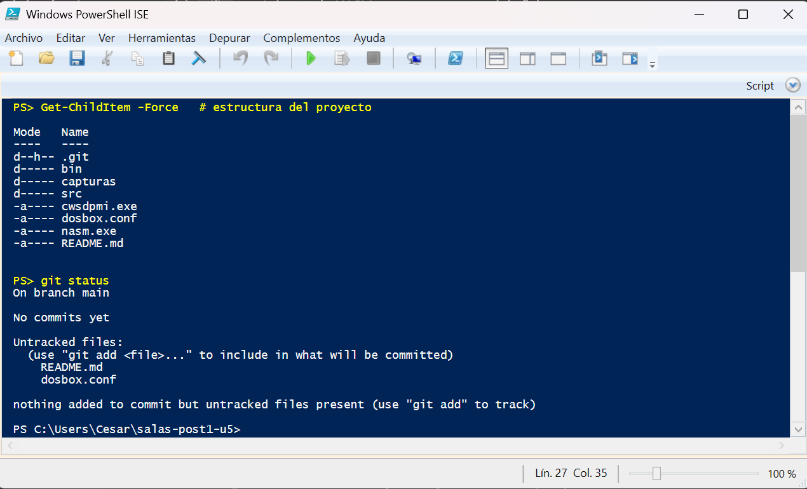
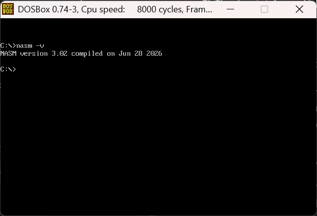
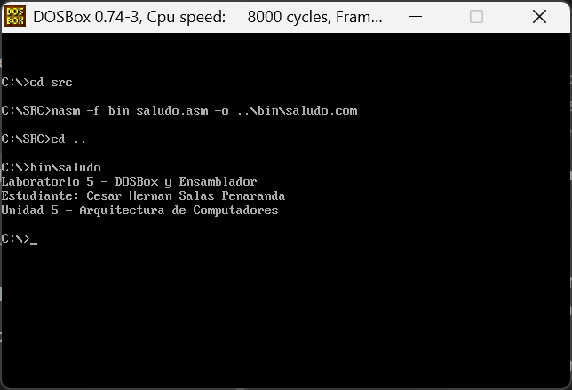
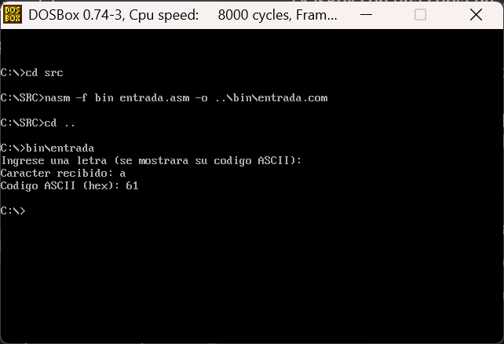


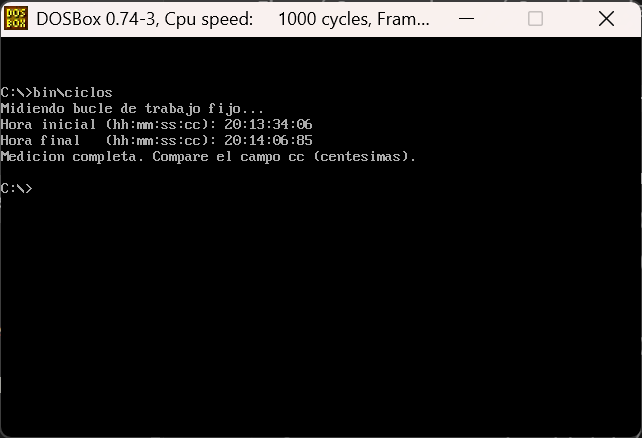
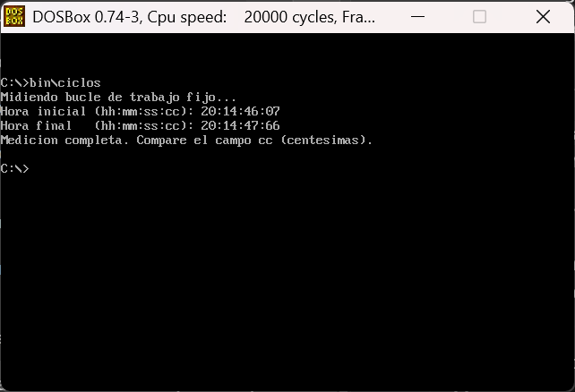


### Sesión DEBUG de `saludo.com`

Con `saludo.com` cargado (`debug bin\saludo.com`):

| Paso | Instrucción | Registros relevantes después |
|---|---|---|
| inicio (`r`) | — | `AX=0000`, `DX=0000`, `CX=0086` (tamaño del archivo, 134 bytes), `IP=0100` |
| `t` 1 | `MOV AH,09` en `0100` | `AX=0900`, `IP=0102` |
| `t` 2 | `MOV DX,010C` en `0102` | `DX=010C` (dirección de `mensaje`), `IP=0105` |
| `t` 3 | `INT 21` en `0105` | `AX=0924`, `IP=0107`: DOS imprime el mensaje y deja `AL=24h` (`$`) |
| `g` | — | el programa termina con `Program terminated normally` |

El desensamblado (`u 100 10f`) muestra `MOV AH,09` / `MOV DX,010C` / `INT 21` / `MOV AX,4C00` / `INT 21`; las filas siguientes son los bytes de la cadena de texto interpretados como instrucciones, algo esperable porque `.data` sigue al código.

### Comparación del efecto de `cycles`

El código fuente no cambia entre corridas; solo varía la línea `cycles` de `dosbox.conf`, y DOSBox se reinició después de cada cambio.

| Corrida | `cycles` | Hora inicial (hh:mm:ss:cc) | Hora final (hh:mm:ss:cc) | Duración observada (centésimas) |
|---|---|---|---|---|
| 1 | 8000 | 20:12:34:47 | 20:12:38:59 | 412 (4,12 s) |
| 2 | 1000 | 20:13:34:06 | 20:14:06:85 | 3279 (32,79 s) |
| 3 | 20000 | 20:14:46:07 | 20:14:47:66 | 159 (1,59 s) |

La duración con 1000 es unas 8 veces la de 8000 (3279 / 412 = 7,96) y la de 20000 es unas 2,6 veces menor (412 / 159 = 2,59), muy cerca de las razones teóricas 8 y 2,5. Esto confirma que `cycles` controla la velocidad de emulación y no la corrección del programa, que ejecuta exactamente las mismas instrucciones.

## Decisiones técnicas (Parte 1)

### Decisión 1: ¿qué valor de `cycles` es el correcto para este laboratorio?

Con `cycles=max`, DOSBox emula tantas instrucciones por segundo como el procesador anfitrión permita, de modo que `ciclos.com`, cuyo bucle de unas 33 millones de instrucciones solo usa el paso del tiempo como espera, terminaría casi al instante en cualquier equipo moderno, sin importar las iteraciones fijadas en el código. Las centésimas medidas dejarían de reflejar el diseño del programa y pasarían a reflejar la potencia del anfitrión, lo que invalida la medición. `cycles=auto` también es inadecuado, porque ajusta la velocidad dinámicamente según el programa activo y el resultado cambia de una corrida a otra. Un valor fijo como `cycles=8000` es determinista: cada milisegundo virtual ejecuta siempre el mismo número de instrucciones, por lo que los resultados son comparables entre equipos distintos. Los datos lo confirman: 412, 3279 y 159 centésimas para 8000, 1000 y 20000. Fuera de este laboratorio, `max` o `auto` sí son la opción correcta para software que no depende del reloj del procesador, como un compilador o ensamblador de DOS, una herramienta de productividad o un entorno como Windows 3.1, donde se busca terminar cuanto antes.

### Decisión 2: tiempo emulado en DOSBox frente a ciclos de CPU reales

Las centésimas que lee la función 2Ch provienen del reloj interno emulado por DOSBox, y `cycles` mide instrucciones x86 emuladas por milisegundo de tiempo virtual, no ciclos de reloj físicos. Compararlo con los varios GHz del procesador anfitrión es un error de categoría: son magnitudes de dominios distintos, una definida dentro de la máquina emulada y la otra en el silicio real. Además, cada instrucción de 16 bits emulada exige que DOSBox la interprete por software con un número variable de instrucciones nativas, de modo que el anfitrión ejecuta muchos más ciclos reales de los que sugiere `cycles`. Por eso `cycles` no indica el uso real de CPU de `DOSBox.exe`: con un valor fijo, DOSBox ejecuta su cuota de instrucciones en cada milisegundo y espera el resto, mientras que con `max` ocupa por completo un núcleo. Para estimar cuántos ciclos reales consume `ciclos.com` dentro de DOSBox hay que medir el proceso en el anfitrión con una herramienta del sistema operativo: el Administrador de tareas o el Monitor de rendimiento (`% de tiempo de procesador` de `DOSBox.exe`), o un perfilador como Windows Performance Analyzer o Process Explorer, y no leer `cycles` del archivo de configuración.

## Parte 2: VirtualBox, creación y gestión de máquinas virtuales

### Entorno de la VM

| Componente | Detalle |
|---|---|
| Virtualizador | Oracle VirtualBox 7.2.22, gestionado con `VBoxManage` desde la consola |
| VM | `Lab5-Alpine` (Other Linux 64-bit) |
| Sistema operativo | Alpine Linux 3.24.4 (edición Standard, x86_64), kernel 6.18 |
| Recursos iniciales | 1 CPU, 1024 MB de RAM, 16 MB de vídeo, NIC en NAT |
| Recursos finales | 2 CPUs, 2048 MB de RAM |
| Discos | `Lab5-Alpine.vdi` dinámico de 10 GB (SATA 0) y `Lab5-Alpine-fixed.vdi` fijo de 4 GB (SATA 1) |
| Anfitrión | Windows 11 Home, 8 procesadores lógicos, 16 GB de RAM, hipervisor de Windows activo |

La VM, sus discos y el `.ova` viven en `C:\Users\Cesar\VMs-lab5\`, fuera del repositorio. **El `.ova` (1380,6 MB) y el disco fijo `.vdi` (4098 MB) no se suben a GitHub** por su tamaño; el proceso queda documentado con capturas y en `VBoxManage_commands.sh`.

### Procedimiento y notas de implementación

1. **Creación** con `VBoxManage createvm`, `modifyvm`, `createmedium`, `storagectl` y `storageattach` (checkpoint 1).
2. **Instalación** de Alpine con `setup-alpine` (teclado `us`, host `lab5-vm`, `eth0` por DHCP, zona `America/Bogota`, `chrony`, espejo 1, sin usuario adicional, `openssh`, disco `sda` en modo `sys`). Después de `poweroff` se retiró la ISO con `storageattach ... --medium emptydrive` y la VM arrancó desde el disco (checkpoint 2).
3. **Redes** NAT, Host-Only y Bridge (checkpoint 3), **snapshots** (checkpoint 4), **recursos** (checkpoint 5), **discos** (checkpoint 6), **decisiones** (checkpoint 7) y **exportación OVA** (checkpoint 8).

Diferencias respecto al enunciado, y por qué:

- **ISO.** Se usó Alpine **3.24.4** en lugar de la 3.19: es la edición Standard x86_64 disponible. El instalador de esta versión pregunta además por IPv6 (se respondió `none`).
- **Sin interfaz del Manager.** La VM se arrancó con `--type headless`. El teclado se controló con `VBoxManage controlvm keyboardputstring` y las capturas de la consola de la VM con `controlvm screenshotpng`. Solo la captura del checkpoint 1 es del VirtualBox Manager.
- **Contraseña de root.** Se definió una contraseña de laboratorio en la instalación; no se versiona ni se muestra en las capturas.
- **Host-Only.** El adaptador `VirtualBox Host-Only Ethernet Adapter` ya existía en el anfitrión (192.168.56.1) y tiene un servidor DHCP en 192.168.56.100, por lo que no hizo falta `hostonlyif create`.
- **Bridge.** Se usó el adaptador Wi-Fi del anfitrión (`Intel(R) Wi-Fi 6E AX211 160MHz`) y solo durante la prueba; la VM volvió a NAT inmediatamente. SSH permitió únicamente `prohibit-password` para root.
- **Snapshots sin `--live`.** El primer intento con `snapshot take --live` no terminó: con el hipervisor de Windows activo VirtualBox no logra seguir las páginas de RAM modificadas y el estado quedó en `livesnapshotting` indefinidamente, de modo que hubo que cerrar el proceso de la VM. Los snapshots definitivos se tomaron con la VM encendida pero sin `--live` (la VM se pausa unos segundos). La VM quedó sin snapshots tras el cierre forzado y se reintentó desde cero.
- **`fdisk`.** El menú interactivo se alimentó con `printf 'n\np\n1\n\n\nw\n' | fdisk /dev/sdb`, equivalente a las teclas del enunciado.

### Capturas de la Parte 2

| Checkpoint | Captura |
|---|---|
| 1. VM creada y configurada (VirtualBox Manager) | `capturas/cp1_vm_config.png` |
| 2. Alpine instalado: `ip addr show eth0` y `ping -c 3 8.8.8.8` | `capturas/cp2_alpine_nat.png` |
| 3. IP en NAT | `capturas/cp3_red_nat.png` |
| 3. IP en Host-Only y `ping 8.8.8.8` fallido | `capturas/cp3_red_hostonly.png` |
| 3. Ping del anfitrión a la VM en Host-Only | `capturas/cp3_ping_anfitrion_hostonly.png` |
| 3. IP en Bridge | `capturas/cp3_red_bridge.png` |
| 4. Árbol de snapshots | `capturas/cp4_snapshots_lista.png` |
| 4. Tras restaurar `snap_base`, `curl` no está instalado | `capturas/cp4_restaurado_sin_curl.png` |
| 5. `nproc` y `free -m` tras el cambio | `capturas/cp5_recursos.png` |
| 6. `time dd` en disco fijo y dinámico (prueba del enunciado) | `capturas/cp6_disco_benchmark.png` |
| 6. Pruebas adicionales | `capturas/cp6_disco_benchmark_fsync.png`, `capturas/cp6_disco_benchmark_grande.png`, `capturas/cp6_disco_benchmark_grande2.png`, `capturas/cp6_disco_benchmark_aleatorio.png` |
| 6. Tamaño de los discos en el anfitrión | `capturas/cp6_disco_tamano_host.png` |
| 7. Decisiones técnicas de red y de disco/recursos (recuento de palabras) | `capturas/cp7_decisiones_vm.png` |
| 8. Exportación OVA (`dir` y contenido del paquete) | `capturas/cp8_exportacion_ova.png` |

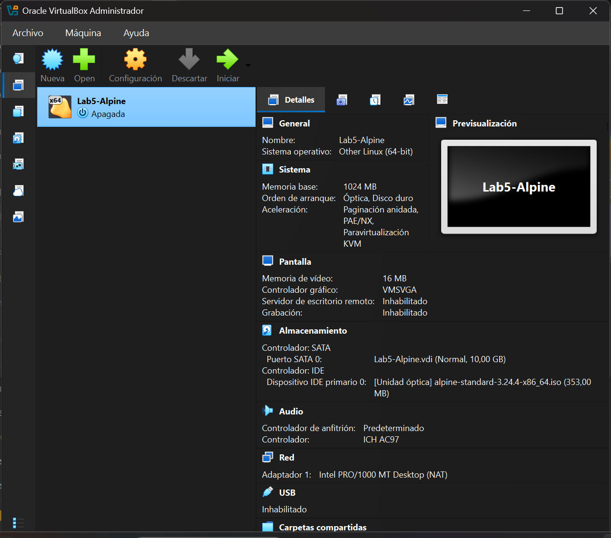
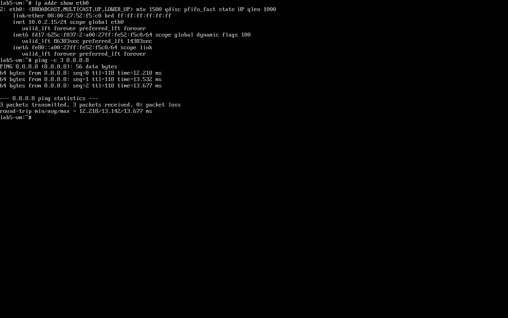
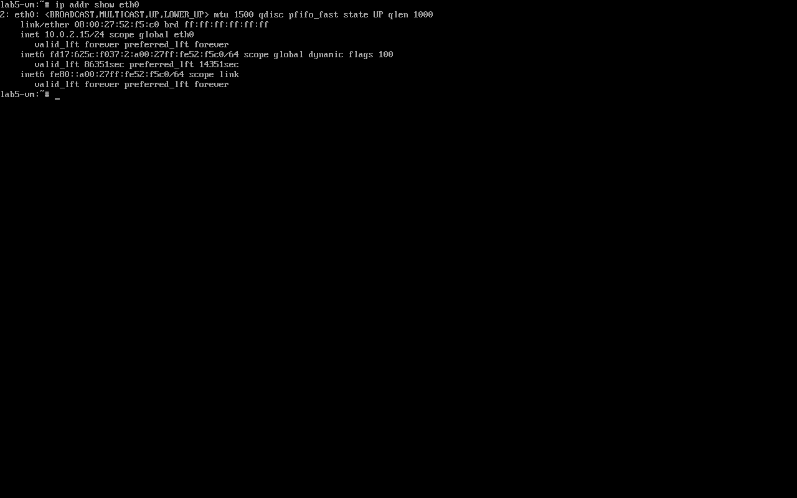
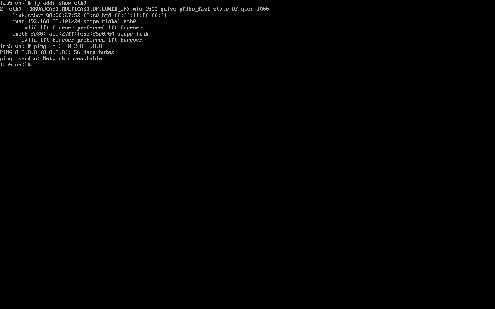
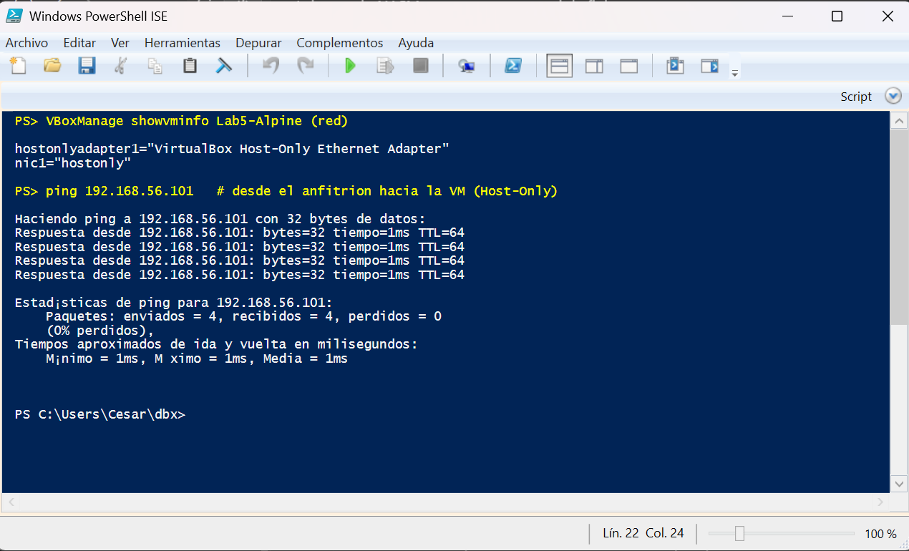
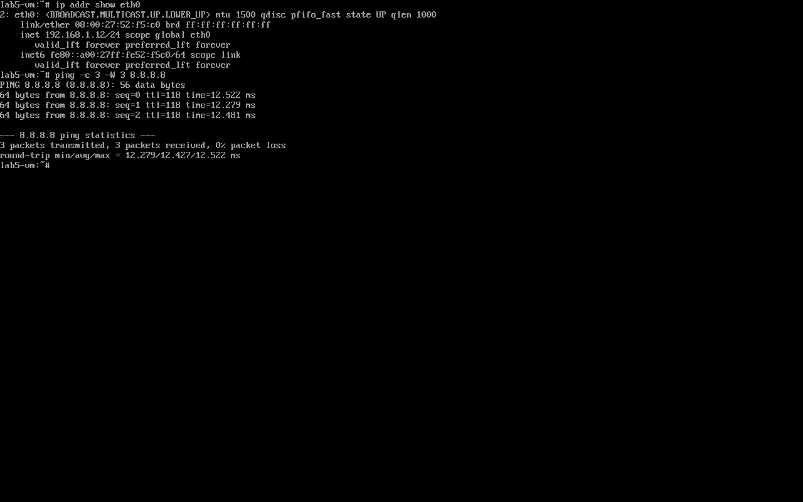
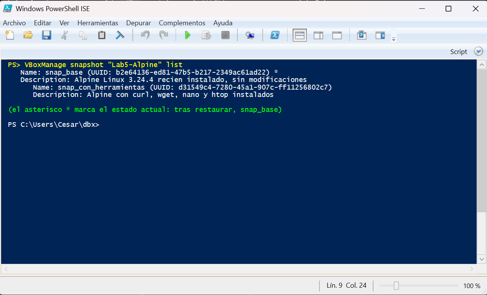
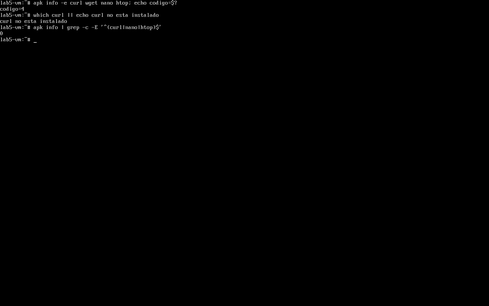
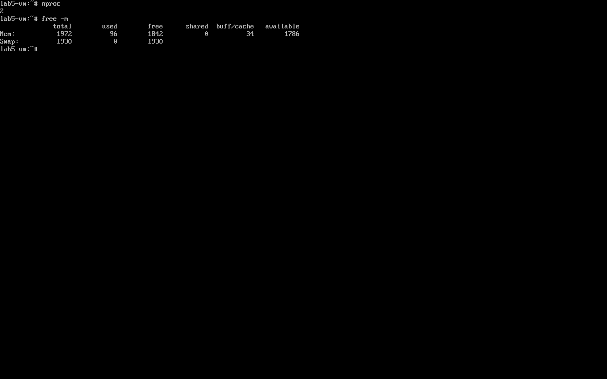
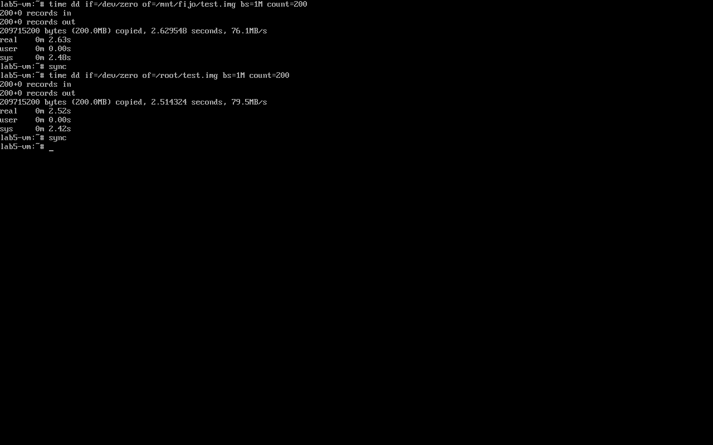
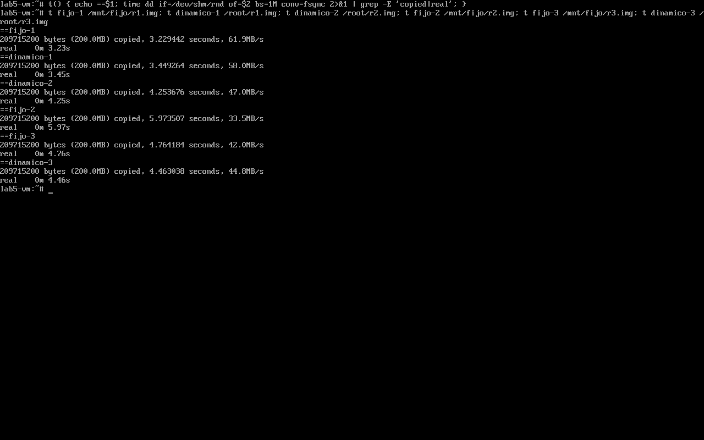
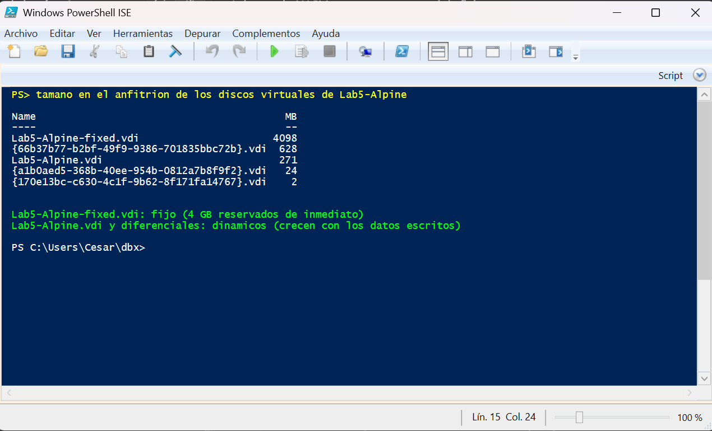
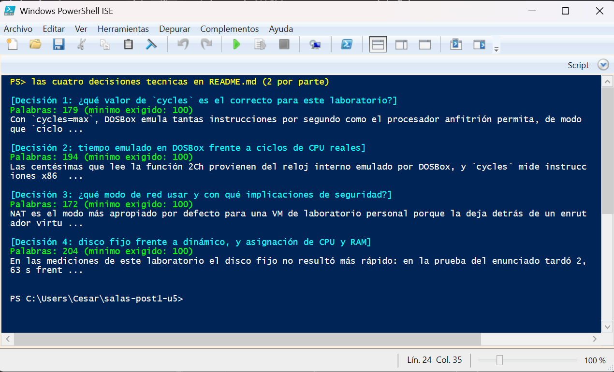
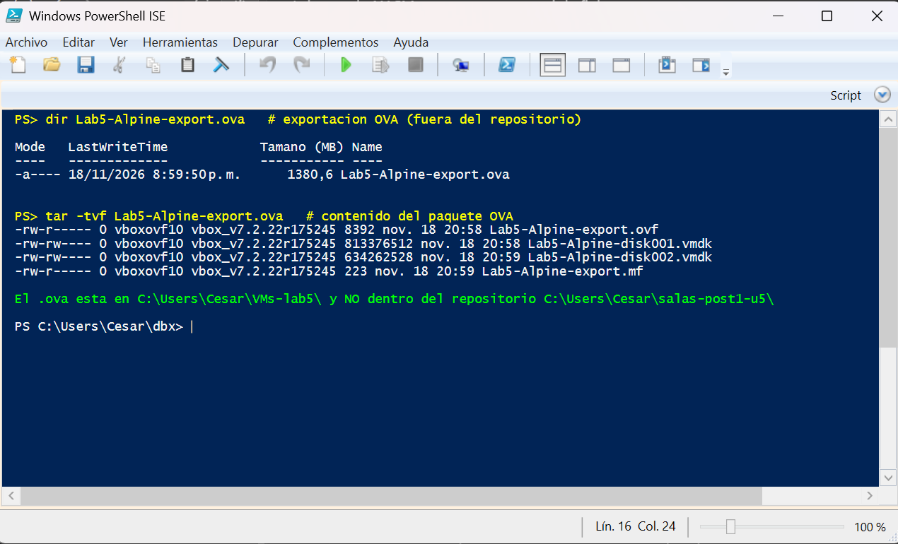

### Modos de red: IP obtenida en cada uno

| Modo | Configuración | IP de la VM | Alcance verificado |
|---|---|---|---|
| NAT | `--nic1 nat` | `10.0.2.15/24` (puerta de enlace `10.0.2.2`) | `ping -c 3 8.8.8.8`: 3/3 respuestas, 0 % de pérdida, ~13 ms |
| Host-Only | `--nic1 hostonly --hostonlyadapter1 "VirtualBox Host-Only Ethernet Adapter"` | `192.168.56.101/24` (DHCP de `192.168.56.100`) | Anfitrión → VM: 4/4 respuestas, ~1 ms. VM → `8.8.8.8`: `Network unreachable` |
| Bridge | `--nic1 bridged --bridgeadapter1 "Intel(R) Wi-Fi 6E AX211 160MHz"` | `192.168.1.12/24` (DHCP del router) | `ping -c 3 8.8.8.8`: 3/3 respuestas, 0 % de pérdida, ~12 ms |

### Árbol de snapshots

```
snap_base                  Alpine Linux 3.24.4 recién instalado, sin modificaciones   (estado actual tras restaurar)
└── snap_con_herramientas  Alpine con curl, wget, nano y htop instalados
```

Tras instalar `curl wget nano htop` con `apk add` y tomar `snap_con_herramientas`, se apagó la VM y se restauró `snap_base`. Dentro de la VM, `apk info -e curl wget nano htop` terminó con código 4 (ninguno instalado) y `which curl` no devolvió nada.

### Recursos: antes y después

| | CPUs | RAM asignada | `nproc` | `free -m` (total) |
|---|---|---|---|---|
| Paso 1 | 1 | 1024 MB | — | — |
| Paso 5 | 2 | 2048 MB | `2` | 1972 MB |

### Comparación de discos: fijo frente a dinámico

Se adjuntó `Lab5-Alpine-fixed.vdi` (fijo, 4 GB) como `/dev/sdb`, formateado en ext4 y montado en `/mnt/fijo`; el disco dinámico es la partición raíz (`/root`). Todas las medidas son el campo `real` de `time`, en segundos.

| Prueba | Disco fijo | Disco dinámico |
|---|---|---|
| A. Enunciado: 200 MB de `/dev/zero`, `time dd ...` (1 corrida) | 2,63 s (76,1 MB/s) | 2,52 s (79,5 MB/s) |
| B. 200 MB de `/dev/zero` con `conv=fsync`, reescribiendo el mismo archivo (3 corridas) | 0,29 / 0,31 / 0,29 (media 0,30) | 0,31 / 0,22 / 0,23 (media 0,25) |
| C. 600 MB de `/dev/zero` con `conv=fsync`, archivo nuevo (2 corridas, orden invertido) | 8,09 s (74,2 MB/s) y 7,42 s (80,9 MB/s) | 3,04 s (197 MB/s) y 0,98 s (612 MB/s) |
| D. 200 MB de datos **aleatorios** con `conv=fsync`, archivos nuevos, orden alternado (3 corridas) | 3,23 / 5,97 / 4,76 (media 4,65) | 3,45 / 4,25 / 4,46 (media 4,05) |

Tamaño de los discos en el anfitrión: el fijo ocupó 4098 MB desde su creación (se creó en 5 s); el dinámico `Lab5-Alpine.vdi` ocupó 271 MB y su imagen diferencial (snapshots) creció de 26 MB a 628 MB tras escribir los 600 MB aleatorios de la prueba D. En cambio, escribir más de 1 GB de ceros (pruebas A a C) casi no la hizo crecer: VirtualBox no reserva bloques para escrituras de solo ceros en un disco dinámico, por lo que las pruebas A a C favorecen al dinámico y la prueba D es la más representativa.

## Decisiones técnicas (Parte 2)

### Decisión 3: ¿qué modo de red usar y con qué implicaciones de seguridad?

NAT es el modo más apropiado por defecto para una VM de laboratorio personal porque la deja detrás de un enrutador virtual: la VM recibe una IP privada (`10.0.2.15`) y puede iniciar conexiones hacia afuera (en la prueba, `ping 8.8.8.8` respondió sin pérdidas), pero ningún otro dispositivo de la red local puede iniciar conexiones hacia ella salvo que se configure un reenvío de puertos. Host-Only sería preferible cuando se quiere experimentar con configuraciones de red, servicios o capturas de tráfico sin exponer la VM a ningún tráfico externo, ni siquiera saliente; a cambio se pierde el acceso a internet, como lo confirmó el `Network unreachable` del `ping`, y no se pueden instalar paquetes con `apk`. Bridge es la opción de mayor riesgo: la VM obtuvo `192.168.1.12`, una dirección en la misma red local que el anfitrión, y queda alcanzable por cualquier dispositivo de esa red, incluidos los servicios que Alpine tenga activos, como `sshd` en el puerto 22, lo que amplía la superficie de ataque frente a intentos de acceso no autorizado.

### Decisión 4: disco fijo frente a dinámico, y asignación de CPU y RAM

En las mediciones de este laboratorio el disco fijo no resultó más rápido: en la prueba del enunciado tardó 2,63 s frente a 2,52 s del dinámico, y con datos aleatorios la media fue 4,65 s frente a 4,05 s, con una dispersión (de 3,2 a 6,0 s) mayor que la diferencia, de modo que no hay una ventaja demostrable. La ventaja teórica del fijo existe, porque no tiene que hacer crecer el archivo `.vdi` ni actualizar su mapa de bloques en el sistema de archivos del anfitrión durante cada escritura, mientras que el dinámico sí; aquí no se hizo visible, probablemente por la caché del anfitrión y el almacenamiento SSD, y las escrituras de ceros ni siquiera reservan bloques en el dinámico. Aun así, el dinámico sigue siendo la opción por defecto en un curso con muchos estudiantes: ocupó 271 MB frente a los 4098 MB que el fijo reservó de inmediato. Asignar 2 CPUs y 2048 MB a Alpine, que apenas usó 96 MB, es razonable en un anfitrión de 8 CPUs y 16 GB; asignar todos los CPUs o la mayor parte de la RAM dejaría sin recursos al anfitrión, que tenía solo unos 4 GB libres, y degradaría ambos sistemas.

## Conclusiones: emulación frente a virtualización

- **Qué se ejecuta y cómo.** DOSBox *emula* un x86 de 16 bits: cada instrucción se interpreta por software, por lo que `cycles` fija cuántas instrucciones emuladas se ejecutan por milisegundo y el tiempo del programa depende de ese parámetro (412, 3279 y 159 centésimas con 8000, 1000 y 20000). VirtualBox *virtualiza*: el código del huésped se ejecuta directamente sobre la CPU del anfitrión con ayuda del hipervisor, de modo que Alpine instaló 13 paquetes y copió 600 MB en segundos sin que ningún parámetro equivalente a `cycles` limitara su velocidad.
- **Recursos.** En DOSBox el equivalente al hardware es una abstracción (`cycles`, `memsize`); en VirtualBox se reparte hardware real del anfitrión (CPUs, RAM, disco) y por eso hay que dimensionarlo: 2 CPUs y 2048 MB de un anfitrión de 8 CPUs y 16 GB.
- **Red.** DOSBox no tiene red relevante para este laboratorio; en VirtualBox el modo de red determina el aislamiento. NAT dio salida a internet con la VM oculta, Host-Only permitió el contacto con el anfitrión sin internet y Bridge puso a la VM en la LAN con IP propia (`192.168.1.12`).
- **Estado y portabilidad.** Los snapshots permitieron deshacer la instalación de software (`curl` desapareció tras restaurar `snap_base`) y la exportación OVA empaquetó la VM (`.ovf`, dos `.vmdk` y manifiesto) para llevarla a otra instalación.
- **Límites observados.** Con el hipervisor de Windows activo, el snapshot en vivo no convergió; la virtualización depende del soporte del anfitrión, mientras que el emulador funciona sin él pero a una fracción de la velocidad.
